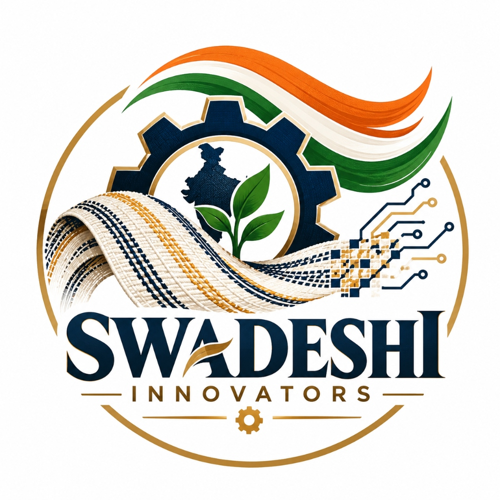
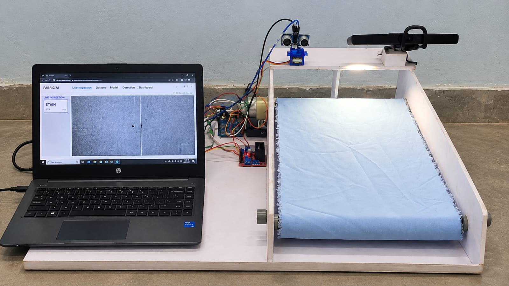
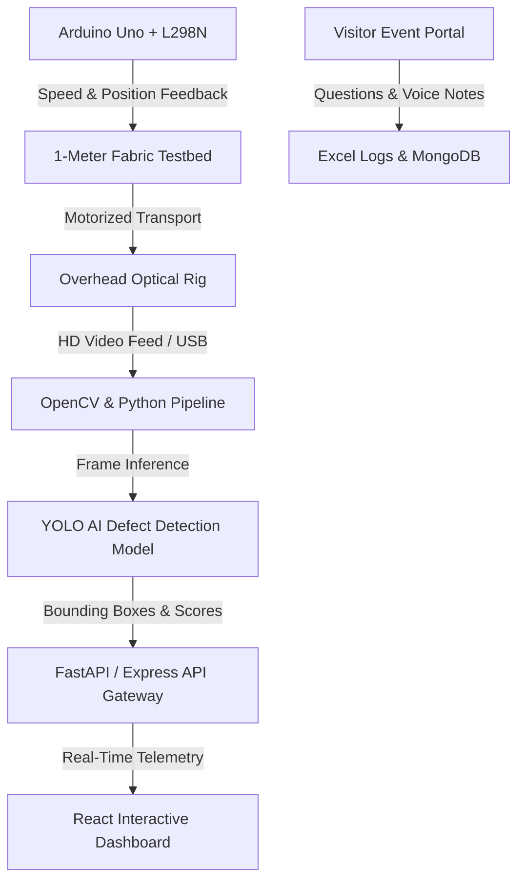

# Swadeshi Innovators — Weave Kiran

## Deploy on Render

Use **two Render services**. The Static Site makes the website fast and public; the Web Service receives form submissions and writes the Excel file.

| Service | Purpose | Render type |
| --- | --- | --- |
| Frontend | Website and `/visitor-question` page | Static Site |
| Backend | APIs and Excel question saving | Web Service |

### 1. Keep the existing API Web Service

Keep `https://swadeshi-innovators.onrender.com` as a **Web Service**. Use these settings:

| Render setting | Value |
| --- | --- |
| Root directory | Leave blank |
| Build command | `npm install && npm run build` |
| Start command | `npm start` |
| Environment | `Node` |

Its API remains available at `https://swadeshi-innovators.onrender.com/api/visitor-questions`.

### 2. Create the Static Site

In Render, click **New +** → **Static Site**, select this same repository, then use:

| Render setting | Value |
| --- | --- |
| Root directory | Leave blank |
| Build command | `npm install && npm run build --workspace client` |
| Publish directory | `client/dist` |

In the Static Site **Environment** section, add:

| Key | Value |
| --- | --- |
| `VITE_API_BASE_URL` | `https://swadeshi-innovators.onrender.com` |
| `VITE_EVENT_QR_URL` | `https://YOUR-STATIC-SITE.onrender.com/visitor-question` |

Replace `YOUR-STATIC-SITE` with the Static Site URL given by Render. Deploy again after adding the variables because Vite includes them during the build.

### 3. Add the page rewrite

In the Static Site dashboard, open **Redirects/Rewrites** and add this rule:

| Source | Destination | Action |
| --- | --- | --- |
| `/*` | `/index.html` | Rewrite |

This makes direct links such as `/visitor-question` open the React page instead of showing a 404.

> A Static Site cannot create or save an Excel file by itself. Keep the backend Web Service running so the question form and contact form continue to work.

> Render's local Web Service filesystem is temporary. For reliable event records, move visitor-question data to MongoDB, a Render Disk, or another persistent storage service instead of relying only on `server/data/visitor-questions.xlsx`.

<div align="center">



### **AI-Powered Fabric Defect Detector**
#### *Innovate • Build • For a Self-Reliant Bharat*

[](https://github.com/Kartikcc123/Swadeshi-Innovators)
[](https://react.dev/)
[](https://vitejs.dev/)
[](https://www.python.org/)
[](https://ultralytics.com/)
[](https://nodejs.org/)

---

### **"AI for Cleaner Fabrics. A Stronger Bharat."**
*Detect Defects • Reduce Waste • Build a Sustainable Textile Future*

</div>

---

## 🌟 Overview

**Weave Kiran** is an authentic, accessible computer vision prototype developed from the ground up by **Swadeshi Innovators** for **Sanrachna IQTSX 2026**. 

Traditional fabric quality inspection in decentralized powerloom and handloom clusters relies heavily on manual human examination. Continuous visual tracking causes severe ocular fatigue, leading to missed defects (such as subtle slub misalignments, tension variations, and oil stains) that slip downstream into cutting, dyeing, and garment assembly—multiplying material, chemical, and energy waste.

**Weave Kiran** bridges this gap through frugal, indigenous engineering—pairing accessible optical capture and open-source edge AI models with an automated rolling fabric testbed to make continuous textile quality inspection practical, affordable, and resource-efficient for Indian textile manufacturers and MSMEs.

---

## 📸 The Authentic Prototype

<div align="center">



*The authentic benchtop prototype rig built from scratch by Swadeshi Innovators, featuring an overhead camera rig, diffused illumination, Arduino-driven 1-meter fabric transport bed, and on-device computer vision software.*

</div>

---

## 👥 The Team Behind Weave Kiran

Proudly representing student innovation and self-reliant manufacturing (*Aatmanirbhar Bharat*) at **Sanrachna IQTSX 2026**:

| Team Member | Role | Core Contributions | Skills & Technologies |
| :--- | :--- | :--- | :--- |
| **Kartik Agarwal** | **Team Leader** | Led all software architecture and implementation: trained custom fabric defect datasets, integrated YOLO26s/YOLOv8 models for real-time anomaly localization, created the interactive dashboard, and engineered the backend APIs. | Python, YOLOv8/26s, OpenCV, FastAPI, React, TailwindCSS, MongoDB, Docker |
| **Ajay Kumar Tamboli** | **Hardware Engineer** | Designed and fabricated the entire physical prototype from scratch: wired and programmed the Arduino Uno microcontroller, L298N motor driver, HC-SR04 ultrasonic sensors, power supply cells, and motorized 1-meter conveyor bed. | Arduino Uno, L298N Driver, Ultrasonic Sensors, Circuit Design, Mechanical Fabrication |
| **Raghvendra Pandey** | **Team Presenter / Speaker** | Primary team spokesperson and communicator: leads presentations, pitches technical workflows and sustainability impact of Weave Kiran to judges, industry specialists, and visitors at Sanrachna IQTSX 2026. | Public Speaking, Project Pitching, Technical Storytelling, Stakeholder Engagement |

---

## 🚀 Key Features & Capabilities

- 🔍 **Real-Time Fabric Defect Detection**: Detects and localizes defects including **Holes & Tears**, **Oil & Dye Stains**, **Slub & Tension Flaws**, **Pattern Misalignments**, and **Loose Threads**.
- 🔬 **High-Resolution Prototype Modal**: Interactive medium-size modal with responsive zoom controls (1x, 1.5x, 2x, Reset), keyboard shortcuts (`+`, `-`, `0`, `Esc`), and hardware/software component breakdowns.
- 🧪 **Live Interactive Inspection Workbench**: Browser-based interactive simulation enabling visitors and judges to upload fabric samples, run multi-class scanning, review confidence scores, and analyze bounding boxes.
- 🌿 **Sustainability & Scrap Reduction**: Designed to catch flaws early in the grey-fabric state, preventing wasted water, dyes, and energy during downstream garment processing.
- 📱 **Sanrachna Event Visitor Portal**: Dedicated `/visitor-question` touchpoint featuring 3D animated visual feedback, live voice-input capture via microphone, QR code phone scan, and automated Excel inquiry logging.
- 💡 **Frugal & Accessible Engineering**: Operates without multimillion-rupee automated optical inspection (AOI) machines—running on standard PCs, affordable optics, and microcontrollers.

---

## 🛠️ Architecture & Tech Stack



### **Frontend Client**
- **Framework**: [React 19](https://react.dev/) + [Vite 6](https://vitejs.dev/)
- **Icons & Visuals**: [Lucide React](https://lucide.dev/)
- **QR Generation**: [qrcode.react](https://www.npmjs.com/package/qrcode.react)
- **Styling**: Vanilla CSS Design System (Saffron, Deep Navy, Khadi Cream palette)

### **Backend & AI Pipeline**
- **Deep Learning**: YOLOv8s / YOLO26s defect detection and classification
- **Computer Vision**: OpenCV (frame normalization, contrast adjustment, bounding box rendering)
- **API Server**: Node.js + Express & Python FastAPI
- **Database**: MongoDB (Mongoose) + Automatic Excel Logging (`xlsx`)

### **Physical Hardware Rig**
- **Microcontroller**: Arduino Uno
- **Motor Control**: L298N Dual H-Bridge Motor Driver
- **Sensory**: HC-SR04 Ultrasonic Distance/Proximity Sensor
- **Optics & Lighting**: Overhead HD Optical Capture Rig with Calibrated Diffused Ring Light
- **Fabric Bed**: 1.0-Meter Continuous Tension-Calibrated Rolling Test Bed

---

## 💻 Getting Started

### **Prerequisites**
- **Node.js**: v18.0.0 or higher
- **npm**: v9.0.0 or higher

### **Installation**

1. Clone the repository:
   ```bash
   git clone https://github.com/Kartikcc123/Swadeshi-Innovators.git
   cd Swadeshi-Innovators
   ```

2. Install all dependencies across both client and server:
   ```bash
   npm install
   ```

3. Start the development servers:
   ```bash
   npm run dev
   ```

### **Service Ports**

| Service | Address | Description |
| :--- | :--- | :--- |
| **Main Website** | `http://localhost:5173` | Full Weave Kiran showcase, interactive demo, team & sustainability sections |
| **Event Visitor Portal** | `http://localhost:5173/visitor-question` | Interactive question kiosk with voice input and QR code for visitors |
| **Backend API** | `http://localhost:5000` | Express API, contact form handler, and Excel question logger |

---

## 📱 Event Visitor Question Kiosk

During **Sanrachna IQTSX 2026**:
1. Open `http://localhost:5173/visitor-question` on the event demonstration laptop or kiosk tablet.
2. Visitors can scan the dynamically generated QR code on their mobile devices to ask questions from their phones, or type/speak directly at the kiosk.
3. Submissions are saved automatically to `server/data/visitor-questions.xlsx` on the host machine.
4. The team can follow up with attendees and judges directly via WhatsApp using the captured phone numbers.

> **LAN / Network Setup**: To allow visitor phones to connect over the venue Wi-Fi, set your laptop's local IP address or configure `VITE_EVENT_QR_URL`:
> ```bash
> VITE_EVENT_QR_URL=http://<YOUR_LOCAL_IP>:5173/visitor-question
> ```

---

## 📂 Project Directory Structure

```text
Swadeshi-Innovators/
├── client/                     # React Frontend Application
│   ├── public/
│   │   └── assets/             # Logos, authentic prototype photo, defect samples
│   │       ├── image.png       # High-resolution prototype photo (1600x900)
│   │       └── swadeshi_logo.png
│   ├── src/
│   │   ├── components/         # Modular React components
│   │   │   ├── Hero.jsx        # Landing hero with clickable HD modal
│   │   │   ├── ImageModal.jsx  # Medium-size inspection box with zoom controls
│   │   │   ├── ProductShowcase.jsx # Interactive defect category explorer
│   │   │   ├── InteractiveSimulator.jsx # Live browser-based CV simulator
│   │   │   ├── ResourceGrid.jsx # Built with limited resources breakdown
│   │   │   ├── SustainabilitySection.jsx # Ecological and scrap impact
│   │   │   ├── TeamSection.jsx # Centered team cards & contributions
│   │   │   └── ...
│   │   ├── data/
│   │   │   └── websiteContent.js # Centralized content configuration
│   │   ├── styles.css          # Comprehensive responsive CSS design system
│   │   └── App.jsx
│   └── package.json
├── server/                     # Node.js + Express Backend
│   ├── src/
│   │   ├── index.js            # API routing, Excel exporter & contact handler
│   │   └── ...
│   ├── data/                   # Saved Excel question files
│   └── package.json
├── .gitignore
├── package.json                # Monorepo workspace configuration
└── README.md
```

---

## 🏆 Competition Entry

- **Event**: Sanrachna IQTSX 2026
- **Team**: Swadeshi Innovators
- **Project**: Weave Kiran — AI-Powered Fabric Defect Detector
- **Repository**: [Kartikcc123/Swadeshi-Innovators](https://github.com/Kartikcc123/Swadeshi-Innovators)

---

<div align="center">
Made with dedication by <strong>Swadeshi Innovators</strong> for a self-reliant Bharat 🇮🇳
</div>
